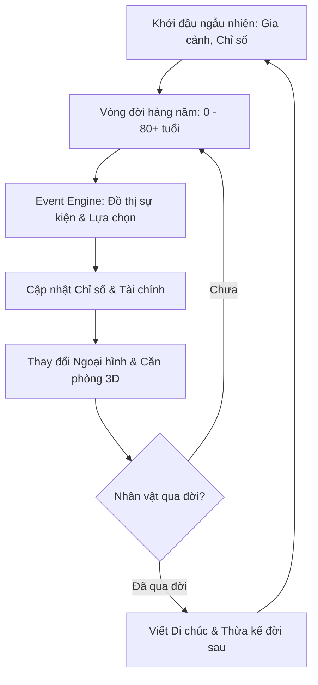

<div align="center">

# 💎 ZERO TO BILLIONAIRE SIMULATOR
### *Từ Tay Trắng Đến Tỉ Phú — Life Sim 3D*

[](https://lukhachyaros.github.io/Zero-to-Billionaire-Simulator/)
[](https://unity.com/)
[](https://developer.apple.com/ios/)
[](https://developer.apple.com/metal/)
[](https://dotnet.microsoft.com/)
[](LICENSE)
[](.github/ISSUE_TEMPLATE/event_proposal.md)

<p align="center">
  <b>Sự kết hợp giữa chiều sâu mô phỏng cuộc đời rẽ nhánh của BitLife và thế giới 3D trực quan sống động của The Sims — gói trọn trong bối cảnh đời sống Việt Nam.</b>
</p>

[🎮 Chơi Ngay Bản Web 3D Online](https://lukhachyaros.github.io/Zero-to-Billionaire-Simulator/) • [Tài liệu Kế hoạch Gốc](docs/ORIGINAL_PLAN.md) • [Kế hoạch Phát triển iOS](docs/IOS_DEVELOPMENT_PLAN.md) • [Kho Dữ liệu Game](data/) • [Đóng góp sự kiện](.github/ISSUE_TEMPLATE/event_proposal.md)

---

</div>

## 📖 Mục lục
- [Giới thiệu dự án](#-giới-thiệu-dự-án)
- [Điểm khác biệt cốt lõi](#-điểm-khác-biệt-cốt-lõi)
- [Giao diện & Trải nghiệm iOS (Mobile-First)](#-giao-diện--trải-nghiệm-ios-mobile-first)
- [Hệ thống Gameplay chính](#-hệ-thống-gameplay-chính)
- [Kiến trúc Kỹ thuật & Tối ưu iOS](#-kiến-trúc-kỹ-thuật--tối-ưu-ios)
- [Cấu trúc Thư mục Dự án](#-cấu-trúc-thư-mục-dự-án)
- [Lộ trình Phát triển (Roadmap)](#-lộ-trình-phát-triển-roadmap)
- [Hướng dẫn Cài đặt & Chạy Dự án](#-hướng-dẫn-cài-đặt--chạy-dự-án)
- [Hướng dẫn Viết Kịch bản / Sự kiện](#-hướng-dẫn-viết-kịch-bản--sự-kiện)
- [Đóng góp & Giấy phép](#-đóng-góp--giấy-phép)

---

## 💡 Giới thiệu dự án

**Zero to Billionaire Simulator** là tựa game mô phỏng cuộc đời (Life Simulation / RPG) dành cho thiết bị di động, lấy trọng tâm tối ưu hóa cho hệ sinh thái **iOS / iPhone**.

Bắt đầu từ một đứa trẻ sơ sinh với hoàn cảnh ngẫu nhiên (từ mồ côi cơ cực, gia đình bình dân đến con nhà trâm anh thế phiệt), bạn sẽ tự tay đưa ra từng quyết định trong cuộc đời: học vấn, kết giao bạn bè, chọn nghề lập nghiệp, đối mặt biến cố, tích lũy tài sản và lập nên gia tộc tỷ đô truyền đời.

```
+-------------------------------------------------------------+
|                      TRIẾT LÝ THIẾT KẾ                      |
+-------------------------------------------------------------+
|  🧠 Bộ não BitLife : Đồ thị sự kiện rẽ nhánh sâu sắc, đa dạng|
|  🏡 Thể xác The Sims: Phòng 3D Diorama Low-poly đổi theo tài sản|
|  🇻🇳 Linh hồn Việt Nam: Đậm chất đời sống văn hóa, gia đình   |
|  📱 Trải nghiệm iPhone: Chơi 1 tay, màn hình dọc, Taptic haptic|
+-------------------------------------------------------------+
```

---

## 🌟 Điểm khác biệt cốt lõi

### 1. Hybrid 3D Diorama + Action Stream
Không còn là những trang văn bản đơn điệu! Game sử dụng bố cục chia đôi màn hình:
* **Nửa trên (3D Diorama):** Không gian sống 3D Isometric phản chiếu trực tiếp độ tuổi, độ giàu có và tâm trạng nhân vật (từ phòng trọ 10m² chật hẹp thời sinh viên đến dinh thự Penthouse triệu đô).
* **Nửa dưới (Event Stream):** Dòng thời gian mượt mà với các thẻ quyết định vuốt/chạm nhanh bằng một ngón tay cái.

### 2. Bản sắc Văn hóa Việt Nam chân thực
* **Giáo dục & Thi cử:** Áp lực thi vào lớp 10, kỳ thi Tốt nghiệp THPT, học đại học top đầu hay học nghề thực chiến.
* **Đời sống & Gia đình:** Áp lực câu hỏi họ hàng ngày Tết ("Bao giờ lấy chồng/vợ?", "Lương tháng bao nhiêu?"), văn hóa phong bao lì xì mùng 1, ăn cơm nhà vs lê la trà đá vỉa hè.
* **Kinh tế & Đầu tư:** Đi làm công chức, làm freelancer, khởi nghiệp quán ăn, đón sóng chứng khoán hoặc săn đất nền ven đô.

### 3. Nghiệp quả & Gia phả Truyền đời (Dynasty Inheritance)
* Khi nhân vật qua đời ở tuổi già (hoặc biến cố bất ngờ), bạn có thể **tiếp tục hành trình bằng đời con cháu**.
* Di chúc, danh tiếng dòng họ, bất động sản hoặc những món nợ chưa trả từ đời cha mẹ sẽ tác động trực tiếp lên thế hệ sau.

---

## 📱 Giao diện & Trải nghiệm iOS (Mobile-First)

Tối ưu hóa chuyên sâu cho người dùng iPhone:

```
+-----------------------------------------------+
|  [ Notch / Dynamic Island - Safe Area ]       |
|                                               |
|           3D ISOMETRIC DIORAMA VIEW           |
|      (Phòng ở, Nội thất, Hoạt ảnh nhân vật)   |
|                                               |
+-----------------------------------------------+
|  Năm: 26 Tuổi | Tài sản: 850.000.000 VNĐ      |
|  Sức khỏe: [======  ] Hạnh phúc: [======== ] |
+-----------------------------------------------+
|  DÒNG THỜI GIAN SỰ KIỆN                       |
|  • Bạn được thăng chức lên Trưởng nhóm.       |
|  • Bạn gái rủ đi du lịch Đà Lạt cuối tuần.   |
|                                               |
|  +-----------------------------------------+  |
|  | THẺ QUYẾT ĐỊNH: Lời mời góp vốn mở quán |  |
|  | [Góp 200tr] [Từ chối khéo] [Xem xét lại]|  |
|  +-----------------------------------------+  |
|                                               |
|             [ +1 TUỔI NÀO! ]                  |
+-----------------------------------------------+
| [Nhân vật]  [Học/Làm]  [Tài sản]  [Xã hội]   |
|  [ Home Indicator Bar - Safe Area ]           |
+-----------------------------------------------+
```

* **Apple Taptic Engine:** Phản hồi xúc giác chân thật qua từng cú chạm chọn lựa, rung mạnh khi trúng giải đặc biệt hay gặp tai nạn bất ngờ.
* **Quản lý Pin & Nhiệt độ (Thermal Protection):** Chạy **60 FPS** khi xem hoạt cảnh 3D; tự động chuyển về **30 FPS** khi người chơi dừng đọc nội dung hoặc mở popup chi tiết để giữ iPhone luôn mát mẻ.
* **Apple App Store Ready:** Tích hợp StoreKit 2 cho IAP (Gói ủng hộ không Pay-to-Win), khai báo Privacy Manifest iOS 17+ và Apple Sign-in / CloudKit Save.

---

## ⚙️ Hệ thống Gameplay chính



* **Chỉ số cá nhân:** Sức khỏe, Trí tuệ, Ngoại hình, Hạnh phúc, Kỷ luật, Áp lực (Stress), Giao tiếp (Charisma), Hiểu biết Tài chính, Kỹ năng Thực chiến, Nhạy bén Kinh doanh, May mắn, Địa vị Xã hội, Phúc đức (Karma), Quan hệ gia đình.
* **Kinh tế & Tài chính thực tế theo độ tuổi:** Trẻ sơ sinh (0–5 tuổi) bắt đầu với `0 đ` (không tự cầm tiền mặt), nhận tiền tiêu vặt học sinh theo hoàn cảnh (6–17 tuổi), nhận **Quỹ Hành trang Tuổi 18** & mở khóa **Quỹ Ủy Thác Thừa Kế** khi trưởng thành, tiếp đến vay ngân hàng (8.5%/năm), thu nhập thụ động, 4 pha Chu kỳ Kinh tế Vĩ mô và 18 loại Tài sản (Bất động sản, Vàng SJC, Cổ phiếu VN30, Quỹ AI, Doanh nghiệp, Siêu xe/Du thuyền).
* **Sự nghiệp & Học vấn:** 4 Hoàn cảnh xuất thân (Mái ấm Tình thương, Bình dân, Công chức Trí thức, Trâm anh Thế phiệt) và 22 Ngành nghề có lộ trình thăng chức, tăng lương, nghỉ hưu.
* **Cỗ Máy Thời Gian & Lưu an toàn:** Lưu tự động kèm SHA-256 Checksum (`SaveSystem.cs`), hỗ trợ quay ngược tối đa 5 năm trước để sửa quyết định sai lầm.
* **Hệ thống sự kiện Data-driven:** 38 kịch bản rẽ nhánh & lặp lại (0–95+ tuổi) lưu trữ độc lập dưới dạng JSON (`data/`), tự động đồng bộ sang Unity `Resources/Data/` và bản Web 3D qua `tools/validate_game_data.py`.
* **Bản Web 3D Three.js Chơi Ngay ([Chơi Online](https://lukhachyaros.github.io/Zero-to-Billionaire-Simulator/) / [web/index.html](web/index.html)):** Engine **Three.js WebGL PBR** đổ bóng mềm với 5 cấp độ phòng siêu chi tiết, nhân vật Chibi cử động có phụ kiện theo tuổi, chế độ Ngày/Đêm, âm thanh Web Audio & tự động lưu LocalStorage.

---

## 🛠️ Kiến trúc Kỹ thuật & Tối ưu iOS

| Thành phần | Công nghệ lựa chọn | Mục đích |
| :--- | :--- | :--- |
| **Engine** | Unity 2022.3 LTS / Unity 6 LTS | Ổn định, tương thích xuất sắc với iOS |
| **Render Pipeline** | Universal Render Pipeline (URP) | Render Low-poly Stylized siêu nhẹ |
| **Graphics API** | Apple Metal | Tối đa hóa hiệu năng GPU Apple Silicon |
| **Texture Format** | ASTC (4x4, 6x6, 8x8) | Nén ảnh chất lượng cao với dung lượng bộ nhớ tối thiểu |
| **Draw Calls Budget** | < 100 calls / frame | Đảm bảo mượt mà ngay cả trên iPhone 11 |
| **RAM Runtime** | < 350 MB | Ngăn ngừa iOS Watchdog tắt ứng dụng đột ngột |
| **Save System** | Encrypted JSON + SQLite + CloudKit | Lưu an toàn tại máy và đồng bộ iCloud |

---

## 📂 Cấu trúc Thư mục Dự án

```
Zero-to-Billionaire-Simulator/
├── .github/
│   ├── workflows/                 # CI kiểm tra dữ liệu, mô phỏng & cú pháp JS/C# (ci.yml)
│   └── ISSUE_TEMPLATE/            # Mẫu báo cáo lỗi & đóng góp kịch bản
├── data/
│   ├── backgrounds/               # 4 Hoàn cảnh xuất thân (starting_backgrounds.json)
│   ├── careers/                   # 22 Ngành nghề & lộ trình thăng chức (careers.json)
│   ├── economy/                   # 18 Tài sản Bất động sản, Đầu tư, Doanh nghiệp (assets.json)
│   └── events/                    # Kho kịch bản sự kiện JSON (0 - 95+ tuổi)
│       ├── life_events_full.json  # Sự kiện cột mốc cuộc đời
│       ├── random_yearly_events.json # Sự kiện ngẫu nhiên hàng năm
│       └── sample_events.json     # File sự kiện mẫu minh họa cho cộng đồng
├── docs/                          # Tài liệu GDD, iOS Plan & 3D Art Pipeline
├── tools/
│   └── validate_game_data.py      # Kiểm tra schema, mô phỏng 0-90 tuổi, DOM & đồng bộ dữ liệu
├── web/                           # Phiên bản 3D Three.js chơi trực tiếp (Deploy GitHub Pages)
│   ├── index.html                 # Giao diện Mobile-First Portrait chuẩn iPhone
│   ├── styles.css                 # Hệ thống Dark-Glassmorphic UI & Safe Area
│   ├── vendor/three.min.js        # Thư viện Three.js WebGL đóng gói cục bộ (offline-ready)
│   ├── diorama3d.js               # Engine 3D WebGL PBR (5 cấp phòng, Chibi, Ngày/Đêm, đổ bóng)
│   ├── audio.js                   # Âm thanh tổng hợp Web Audio & rung Haptic
│   ├── game.js                    # Vòng lặp mô phỏng đầy đủ + Lưu LocalStorage
│   └── game_data.js               # Bundle dữ liệu tự đồng bộ từ data/
├── index.html                     # Bản Web 3D đồng bộ tại thư mục gốc (deploy trực tiếp từ nhánh main)
├── .nojekyll                      # Tắt Jekyll processing trên GitHub Pages
├── unity/                         # Dự án Unity Game Client (URP / iOS Metal)
│   ├── Packages/manifest.json     # Khai báo URP, TextMeshPro, InputSystem, Test Framework
│   └── Assets/
│       ├── Plugins/iOS/           # Objective-C++ Taptic Bridge (.mm) & PrivacyInfo.xcprivacy
│       ├── Resources/Data/        # Dữ liệu JSON đồng bộ tải nhanh lúc runtime
│       ├── Scripts/
│       │   ├── Core/              # GameManager, GameBootstrapper, Career, Economy, Relationship, SaveSystem
│       │   ├── Events/            # EventEngine (hỗ trợ Formula & Chaining), GameEventModels
│       │   ├── Models/            # ModularCharacter & ProceduralRoomGenerator 3D
│       │   ├── UI/                # DioramaViewController & MobilePortraitUI
│       │   └── Mobile/iOS/        # IOSHapticFeedback & AdaptiveFrameRateManager (60/30 FPS)
│       └── Tests/EditMode/        # Unit Test mô phỏng lõi C# (GameSimulationTests.cs)
├── .gitattributes                 # Cấu hình Git LFS cho 3D, Texture, Audio
├── .gitignore                     # Bộ lọc hoàn chỉnh cho Unity, iOS/Xcode & OS
├── LICENSE                        # Giấy phép phần mềm mã nguồn mở MIT
└── README.md                      # Tài liệu tổng quan dự án
```

---

## 🗺️ Lộ trình Phát triển (Roadmap)

- [x] **Giai đoạn 0: Thiết lập & Lập kế hoạch**
  - [x] Phân tích GDD và kiến trúc kỹ thuật.
  - [x] Thiết lập chuẩn Repository, Git LFS, .gitignore Unity/iOS, CI Workflow.
  - [x] Xây dựng kế hoạch tối ưu hóa chuyên sâu cho iOS/iPhone và tài liệu 3D Art Pipeline.
- [x] **Giai đoạn 1: Prototype Core Loop & Hệ thống Dữ liệu**
  - [x] Xây dựng Event Engine hoàn chỉnh (Data-driven JSON, hỗ trợ `conditionFormula` & `nextEventId`).
  - [x] Hoàn thiện hệ thống Nghề nghiệp (22 nghề), Kinh tế Vĩ mô & Tài sản (18 loại), Quan hệ Gia phả & Thừa kế, Cỗ máy Thời gian và Lưu game SHA-256.
  - [x] Xây dựng bộ kiểm định dữ liệu, mô phỏng không đầu 0–90 tuổi và Unit Test C# (`tools/validate_game_data.py`, `GameSimulationTests.cs`).
- [x] **Giai đoạn 2: Playable 3D Vertical Slice (Web + Unity Core)**
  - [x] Ra mắt bản chơi thử ngay trên trình duyệt (`web/index.html`) với 3D Isometric Diorama 5 cấp độ phòng & âm thanh.
  - [x] Xây dựng `GameBootstrapper.cs`, `ProceduralRoomGenerator.cs`, `ModularCharacter.cs` tự động dựng cảnh URP trong Unity.
  - [x] Tích hợp Native iOS Taptic Bridge (`IOSHapticBridge.mm`), `PrivacyInfo.xcprivacy` và `AdaptiveFrameRateManager` (60/30 FPS).
  - [ ] Nạp bộ model 3D Blender/FBX hoàn chỉnh và xuất bản build TestFlight nội bộ.
- [ ] **Giai đoạn 3: Mở rộng Nội dung & Alpha TestFlight**
  - [ ] Mở rộng kho kịch bản đạt mốc 500+ sự kiện đậm chất đời sống Việt Nam.
  - [ ] Kết nối đầy đủ các Prefab UI Unity cho 5 màn hình tab chi tiết.
- [ ] **Giai đoạn 4: Closed Beta & Soft Launch iOS**
  - [ ] Mở rộng 300 tester trên Apple TestFlight.
  - [ ] Tích hợp StoreKit 2 IAP & Quảng cáo nhận thưởng.
  - [ ] Ra mắt chính thức trên Apple App Store Việt Nam.
- [ ] **Giai đoạn 5: Multiplayer & Mở rộng Quốc tế**
  - [ ] Tính năng xã hội bất đồng bộ (Bảng xếp hạng đại gia, ghé thăm cơ ngơi bạn bè).
  - [ ] Gói nội dung bản địa hóa các quốc gia khác (Thái Lan, Hàn Quốc, Nhật Bản...).

---

## 🚀 Hướng dẫn Cài đặt & Chạy Dự án

### Cách 1: Chơi thử ngay trên Trình duyệt (Không cần Unity)
1. **Mở trực tiếp:** Mở file [`web/index.html`](web/index.html) bằng Chrome, Safari hoặc Edge (hoạt động hoàn toàn offline), **hoặc** chạy máy chủ cục bộ:
   ```bash
   python -m http.server 8080
   ```
   Sau đó truy cập `http://localhost:8080/web/` (khuyến nghị thu nhỏ cửa sổ hoặc mở trên điện thoại để trải nghiệm khung dọc iPhone).
2. **Kiểm tra & Đồng bộ dữ liệu sau khi sửa JSON trong `data/`:**
   ```bash
   python tools/validate_game_data.py --sync
   ```

### Cách 2: Mở & Chạy trên Unity (Phát triển iOS / Mobile)
#### Yêu cầu tiên quyết
* **Hệ điều hành:** macOS (khuyến nghị để build Xcode/iOS) hoặc Windows 10/11.
* **Unity Hub & Engine:** Unity **2022.3 LTS** (hoặc Unity 6 LTS) có cài đặt module **iOS Build Support**.
* **Xcode:** Phiên bản 15.0+ (nếu build ra thiết bị iPhone/iPad).
* **Git LFS:** Đã cài đặt `git lfs` trên máy tính (`git lfs install`).

#### Các bước khởi tạo
1. **Clone repository (kèm LFS):**
   ```bash
   git clone https://github.com/lukhachyaros/Zero-to-Billionaire-Simulator.git
   cd Zero-to-Billionaire-Simulator
   git lfs pull
   ```
2. **Mở dự án trong Unity:**
   * Mở **Unity Hub** -> Chọn **Add project from disk**.
   * Chọn thư mục `unity/` trong repository.
   * Chờ Unity hoàn tất nạp Package (`manifest.json`) và khởi tạo Shader cache.
   * Mở một Scene bất kỳ và nhấn **Play** — `GameBootstrapper.cs` sẽ tự động dựng Camera Isometric, ánh sáng, phòng 3D Diorama, nhân vật Chibi và nạp toàn bộ dữ liệu từ `Resources/Data/`.
3. **Chuyển nền tảng sang iOS:**
   * Vào `File` -> `Build Settings`.
   * Chọn nền tảng **iOS** -> Bấm **Switch Platform**.
   * Trong phần `Player Settings`:
     * Target minimum iOS version: `16.0`.
     * Graphics API: `Metal`.
     * Texture Compression: `ASTC`.

---

## ✍️ Hướng dẫn Viết Kịch bản / Sự kiện

Bạn không cần biết lập trình Unity vẫn có thể đóng góp vào kho tàng hàng ngàn câu chuyện rẽ nhánh của game!

Mỗi sự kiện được định nghĩa đơn giản trong thư mục [`data/events/`](data/events/sample_events.json):

```json
{
  "eventId": "evt_unique_id",
  "title": "Tiêu đề tình huống",
  "minAge": 18,
  "maxAge": 25,
  "description": "Đoạn văn miêu tả sự việc xảy ra...",
  "options": [
    {
      "id": "opt_choice_a",
      "label": "Lựa chọn hành động A",
      "outcomes": [
        {
          "probability": 0.8,
          "message": "Kết quả nếu thành công!",
          "statModifiers": { "money": 10000000, "happiness": 10 }
        }
      ]
    }
  ]
}
```

👉 Hãy tạo một [Pull Request](https://github.com/lukhachyaros/Zero-to-Billionaire-Simulator/pulls) hoặc gửi đề xuất tại [Event Proposal Template](.github/ISSUE_TEMPLATE/event_proposal.md).

---

## 🤝 Đóng góp & Giấy phép

Dự án phát triển theo giấy phép mã nguồn mở [MIT License](LICENSE). Mọi ý kiến đóng góp kịch bản, 3D low-poly model hoặc đề xuất tính năng đều được hoan nghênh nồng nhiệt!

<div align="center">
  <sub>Được ấp ủ và phát triển với niềm tự hào game mô phỏng Việt Nam 🇻🇳</sub>
</div>
