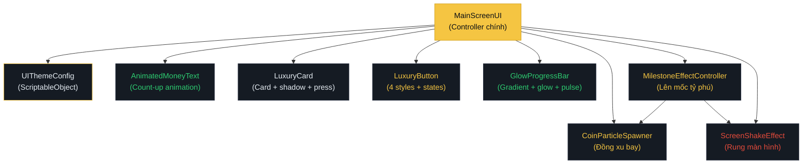

# 🎨 Zero to Billionaire — Luxury Dark Mode UI Redesign

> [!IMPORTANT]
> Tài liệu này mô tả toàn bộ hệ thống UI mới. Logic game **không bị thay đổi**.

## Tổng Quan Thiết Kế



---

## Bảng Màu

| Vai trò | Hex | Mẫu | Dùng cho |
|---------|-----|------|----------|
| Nền chính | `#0B0F14` | 🟫 | Background toàn app |
| Bề mặt | `#151B23` | 🟫 | Card, panel, bottom sheet |
| Bề mặt nâng | `#1C2333` | 🟫 | Card lồng, popup |
| Viền | `#2A3142` | 🟫 | Border card, separator |
| Vàng nhấn | `#F5C542` | 🟡 | Accent, title, border hover, CTA |
| Vàng đậm | `#D4A017` | 🟠 | Gradient, pressed state |
| Xanh lời | `#2ECC71` | 🟢 | Lợi nhuận, stat tốt |
| Đỏ lỗ | `#E74C3C` | 🔴 | Thua lỗ, stat nguy hiểm |
| Cam cảnh báo | `#F39C12` | 🟠 | Stat trung bình |
| Chữ chính | `#E6EDF3` | ⚪ | Body text, số liệu |
| Chữ phụ | `#8D9CAB` | 🔘 | Label, caption |
| Chữ vô hiệu | `#4A5568` | ⚫ | Disabled text |

---

## Cấu Trúc File Mới

```
unity/Assets/Scripts/UI/
├── Theme/
│   └── UIThemeConfig.cs              ← ScriptableObject bảng màu & cấu hình
├── Components/
│   ├── AnimatedMoneyText.cs          ← Số tiền đếm nhảy mượt
│   ├── LuxuryCard.cs                 ← Card với viền, bóng, animation
│   ├── LuxuryButton.cs              ← Nút với 4 style + hover/active/disabled
│   └── GlowProgressBar.cs           ← Thanh tiến trình gradient + glow
├── Effects/
│   ├── CoinParticleSpawner.cs        ← Đồng xu bay particle
│   ├── MilestoneEffectController.cs  ← Hiệu ứng lên mốc triệu/tỷ phú
│   └── ScreenShakeEffect.cs         ← Rung màn hình
├── MainScreenUI.cs                   ← Controller chính (thay MobilePortraitUI)
└── DioramaViewController.cs          ← GIỮ NGUYÊN
```

---

## Hướng Dẫn Setup Trong Unity

### Bước 1: Import Fonts

1. Download fonts:
   - **Orbitron** (tiêu đề): [Google Fonts](https://fonts.google.com/specimen/Orbitron)
   - **JetBrains Mono** (số tiền): [JetBrains](https://www.jetbrains.com/lp/mono/)
   - **Inter** hoặc **Noto Sans** (body): [Google Fonts](https://fonts.google.com/specimen/Inter)

2. Import `.ttf` files vào `Assets/Fonts/`

3. Tạo TextMeshPro Font Asset cho mỗi font:
   - Window → TextMeshPro → Font Asset Creator
   - Chọn file `.ttf` → Atlas Resolution: 2048×2048
   - Character Set: Extended ASCII + Vietnamese
   - Generate → Save vào `Assets/Fonts/TMP/`

### Bước 2: Tạo Theme Asset

1. Project window → Right-click → **Create → Zero to Billionaire → UI Theme Config**
2. Đặt tên: `LuxuryTheme`
3. Di chuyển vào `Assets/Resources/` (để auto-load)
4. Gắn 3 font assets vào các slot `titleFont`, `bodyFont`, `moneyFont`

### Bước 3: Setup Scene Hierarchy

Tạo UI hierarchy trong Scene (hoặc dùng Prefab):

```
Canvas (Screen Space - Camera, 1080×1920)
├── MainBackground (Image, stretch full, color #0B0F14)
├── AmbientGlow (Image, center, soft radial gradient, alpha thấp)
├── SafeAreaPanel (RectTransform, stretch)
│   ├── TitleBar
│   │   ├── TitleBarBg (Image, #151B23, top anchor, height 60)
│   │   └── TitleText (TMP, "✦ ZERO TO BILLIONAIRE ✦", Orbitron)
│   │
│   ├── ScrollContent (Vertical Layout Group, padding 16)
│   │   ├── NetWorthCard ← [LuxuryCard component]
│   │   │   ├── Shadow3 (Image, black 15%, offset 0,12)
│   │   │   ├── Shadow2 (Image, black 25%, offset 0,6)
│   │   │   ├── Shadow1 (Image, black 40%, offset 0,2)
│   │   │   ├── CardBg (Image, #151B23, rounded sprite)
│   │   │   ├── CardBorder (Image, gold 20%, outline sprite)
│   │   │   ├── GlowOverlay (Image, gold 0%, additive)
│   │   │   ├── NetWorthLabel (TMP, "TÀI SẢN RÒNG")
│   │   │   ├── NetWorthValue (TMP, monospace) ← [AnimatedMoneyText]
│   │   │   ├── MonthlyIncomeRow
│   │   │   │   ├── TrendArrow (Image, ▲)
│   │   │   │   ├── MonthlyLabel (TMP)
│   │   │   │   └── MonthlyValue (TMP) ← [AnimatedMoneyText]
│   │   │
│   │   ├── InfoCardsRow (Horizontal Layout Group)
│   │   │   ├── AgeCard ← [LuxuryCard]
│   │   │   │   ├── AgeLabel (TMP, "TUỔI")
│   │   │   │   └── AgeValue (TMP, "25")
│   │   │   ├── JobCard ← [LuxuryCard]
│   │   │   ├── EducationCard ← [LuxuryCard]
│   │   │   └── StatusCard ← [LuxuryCard]
│   │   │
│   │   └── StatsCard ← [LuxuryCard]
│   │       ├── HealthBar ← [GlowProgressBar]
│   │       │   ├── Track (Image, dark)
│   │       │   ├── GlowFill (Image, blurred, behind fill)
│   │       │   ├── Fill (Image, filled, green)
│   │       │   ├── Icon (Image, ❤️)
│   │       │   ├── Label (TMP, "Sức khỏe")
│   │       │   └── Value (TMP, "85")
│   │       ├── HappinessBar ← [GlowProgressBar]
│   │       ├── IntelligenceBar ← [GlowProgressBar]
│   │       ├── DisciplineBar ← [GlowProgressBar]
│   │       ├── StressBar ← [GlowProgressBar]
│   │       └── AppearanceBar ← [GlowProgressBar]
│   │
│   └── AgeUpButton ← [LuxuryButton, Primary]
│       ├── ButtonBg (Image, gold)
│       ├── ButtonBorder (Image, dark gold)
│       └── ButtonText (TMP, "🎂 SỐNG THÊM 1 NĂM")
│
├── BottomSheet (RectTransform, anchored bottom, slides up)
│   ├── BottomSheetCanvas (CanvasGroup)
│   │   ├── EventCard ← [LuxuryCard]
│   │   │   ├── CategoryText (TMP, "SỰ KIỆN")
│   │   │   ├── EventTitle (TMP, Orbitron)
│   │   │   ├── EventDescription (TMP, Inter)
│   │   │   └── OptionsContainer (Vertical Layout Group)
│   │   │       └── (Buttons spawned dynamically)
│   │   └── ResultPanel (CanvasGroup)
│   │       ├── ResultIcon (Image)
│   │       └── ResultMessage (TMP)
│
├── EffectsLayer (RectTransform, stretch, raycastTarget=false)
│   ├── FullScreenFlash (Image, gold, alpha=0)
│   ├── ShimmerOverlay (Image, gradient strip, inactive)
│   └── MilestonePopup (CanvasGroup, center, alpha=0)
│       ├── PopupBg (Image, #1C2333, rounded)
│       ├── MilestoneTitle (TMP, Orbitron, gold)
│       └── MilestoneSubtitle (TMP, Inter, white)
│
├── ParticleLayer
│   └── CoinParticleSpawner ← [CoinParticleSpawner]
│       ├── CoinParticles (ParticleSystem)
│       └── SparkParticles (ParticleSystem)
│
└── ScreenShake ← [ScreenShakeEffect] (gắn vào Canvas hoặc SafeAreaPanel)
```

### Bước 4: Gắn Components

1. Gắn `MainScreenUI` vào Canvas root
2. Kéo-thả tất cả references vào Inspector
3. Gắn `UIThemeConfig` (LuxuryTheme asset) vào mọi component có field `theme`
4. Gắn `MilestoneEffectController` vào EffectsLayer

### Bước 5: Tạo Sprites

Bạn cần tạo các sprite cho:

| Sprite | Dùng cho | Mô tả |
|--------|----------|-------|
| `card_bg_rounded` | Card background | Rounded rect 12px, 9-slice |
| `card_border_rounded` | Card border | Outline-only rounded rect, 9-slice |
| `progress_track` | Bar background | Pill shape, 9-slice |
| `progress_fill` | Bar fill | Pill shape, 9-slice |
| `coin_sprite` | Particle coin | 32×32 gold coin icon |
| `arrow_up` | Trend indicator | Simple triangle/arrow |
| `shimmer_gradient` | Shimmer effect | White→transparent gradient strip |

> [!TIP]
> Dùng **Sprite Editor** với 9-slice border để card và bar co giãn đúng trên mọi kích thước màn hình.

---

## Tính Năng Chi Tiết

### 💰 Count-Up Animation (AnimatedMoneyText)
- Số tiền nhảy mượt từ giá trị cũ → mới
- Ease-out curve: nhanh đầu, chậm cuối
- Punch scale khi thay đổi (nhú lên 1.08x rồi thu lại)
- Flash màu xanh/đỏ theo chiều thay đổi
- Format VNĐ: `₫1.234.567.890` hoặc viết tắt `₫1.2B`

### 🪙 Coin Particles (CoinParticleSpawner)
- **Burst nhỏ** (3-12 xu): khi age up có thu nhập
- **Burst lớn** (30 xu): khi đạt milestone
- **Mưa tiền**: khi lên tỷ phú — rơi từ trên xuống 3 giây
- Xu có spin, gravity, fade out
- Spark nhỏ đi kèm

### 🏆 Milestone Effects (MilestoneEffectController)
8 mốc milestone với hiệu ứng tăng dần:

| Mốc | VNĐ | Hiệu ứng |
|------|------|----------|
| 100K | 100.000 | Flash nhẹ |
| Triệu | 1.000.000 | Flash + popup |
| 10M | 10.000.000 | Flash + shake + popup |
| 100M | 100.000.000 | Flash + shake + coins + shimmer |
| **Tỷ phú** | 1.000.000.000 | **Full combo + mưa tiền** |
| 10B | 10 tỷ | Full combo intensified |
| 100B | 100 tỷ | Full combo + extra shake |
| **Nghìn tỷ** | 1.000 tỷ | **Maximum everything** |

Chuỗi hiệu ứng: Flash → Shake → Coin burst → Shimmer sweep → Popup → Money rain

### 🎴 LuxuryCard
- Viền mảnh vàng (20% opacity bình thường, 50% khi nhấn)
- 3 lớp bóng đổ (gần→xa, đậm→nhạt)
- Press: thu nhỏ 97%, viền sáng
- Hover (PC): phóng lên 102%
- Flash border khi có update quan trọng
- Glow overlay cho highlight

### 🔘 LuxuryButton — 4 Styles

````carousel
**Primary (CTA chính)**
- Nền vàng `#F5C542`, chữ đen
- Pressed: vàng đậm, scale 95%
- Disabled: nền tối `#3A3520`, chữ xám
- Dùng cho: "Sống thêm 1 năm", "Sống lại"
<!-- slide -->
**Secondary (Lựa chọn)**
- Nền trong suốt, viền vàng, chữ vàng
- Pressed: fill vàng, chữ đen (invert)
- Disabled: viền xám, chữ xám
- Dùng cho: Option buttons trong event
<!-- slide -->
**Danger (Hành động nguy hiểm)**
- Nền đỏ `#E74C3C`, chữ trắng
- Pressed: đỏ đậm
- Dùng cho: Reset, xoá save
<!-- slide -->
**Ghost (Phụ)**
- Hoàn toàn trong suốt, chữ xám
- Hover: nền trắng 3%
- Dùng cho: Secondary actions
````

### 📊 GlowProgressBar
- Fill image với gradient theo giá trị
- Glow blur phía sau fill (alpha thấp)
- Auto-color: xanh (>70%) → cam (40-70%) → đỏ (<40%)
- Pulse glow khi critical (<20%) hoặc full (100%)
- Flash animation khi thay đổi >10 điểm

---

## Mapping: Logic Game → UI

> [!NOTE]
> Không có dòng code logic nào bị sửa. `MainScreenUI` subscribe vào events của `GameManager` y hệt `MobilePortraitUI` cũ.

| Logic (giữ nguyên) | UI mới |
|---------------------|--------|
| `GameManager.AgeUp()` | `HandleAgeUp()` → update tất cả + coin burst + shake |
| `GameManager.OnEventTriggered` | `DisplayEvent()` → bottom sheet slide up |
| `EventEngine.ResolveOption()` | `SelectOption()` → coin burst + update displays |
| `CharacterStats.cash` | `AnimatedMoneyText.SetValue()` → count-up animation |
| `CharacterStats.health` | `GlowProgressBar.SetValue()` → smooth fill + auto color |
| `GameManager.OnGameOver` | `ShowGameOverDisplay()` → bottom sheet + disable controls |
| Cash thay đổi lớn | `MilestoneEffectController.CheckMilestone()` → celebration |

---

## Tiếp Theo

Khi bạn sẵn sàng, tôi sẽ thiết kế tiếp:
- 🏪 **Màn hình Cửa hàng / Đầu tư** — card grid với giá, ROI, unlock conditions
- 📊 **Màn hình Thống kê** — biểu đồ tài sản theo thời gian, pie chart chi tiêu
- ⚙️ **Màn hình Cài đặt** — switches, sliders luxury
- 🏆 **Màn hình Thành tựu** — achievement cards với unlock animation
